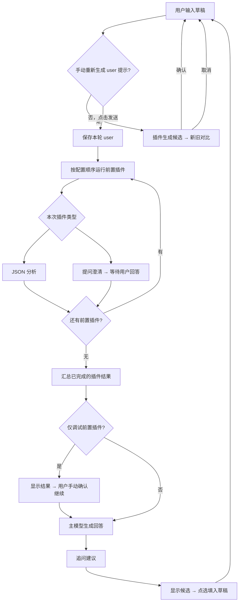
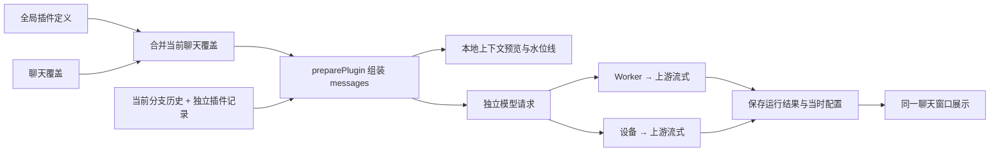
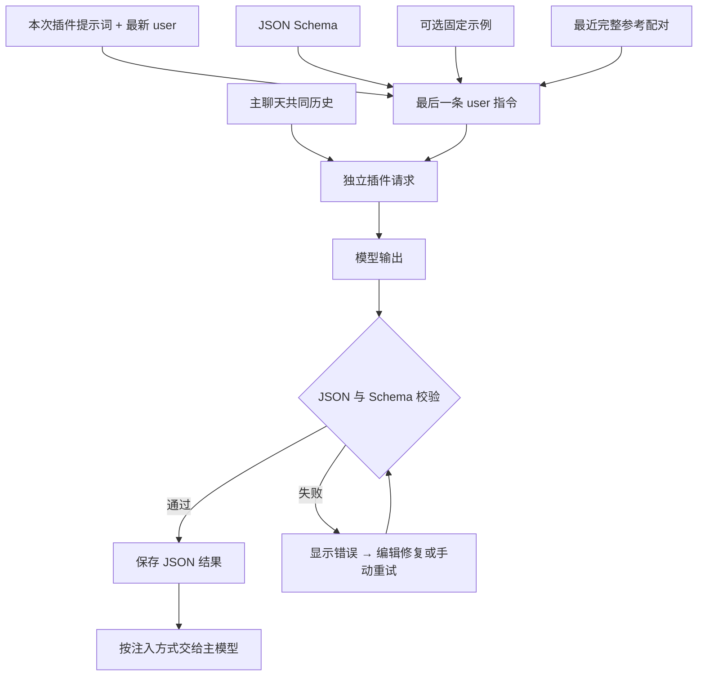
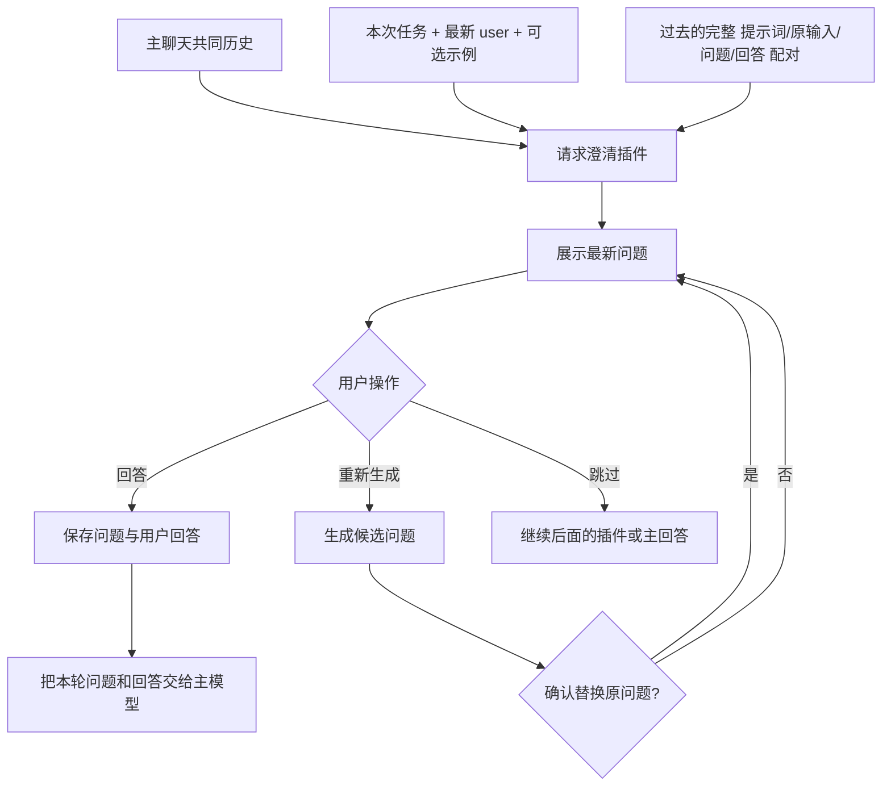
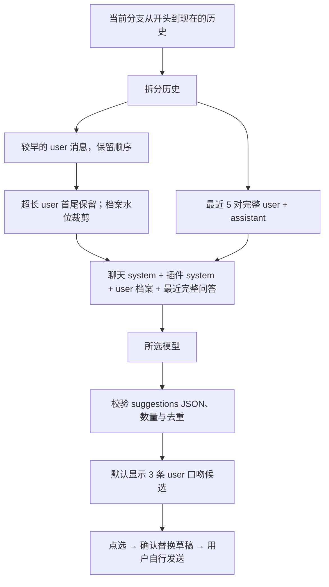
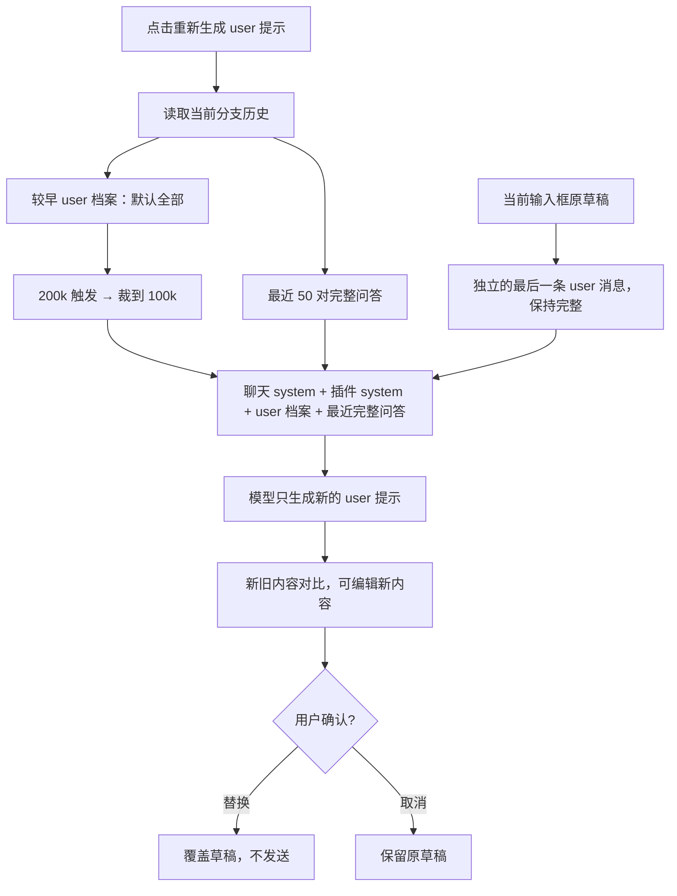
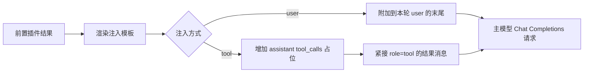

# 插件工作原理与默认提示词

这份文档面向调整提示词的人，也可整份交给其他 AI 阅读。四个插件都是独立的模型调用，共用聊天窗口展示；它们的结果和用户对插件的回答存放在独立插件记录中，不会变成聊天正文里的 assistant 消息。聊天 JSON/Markdown 导出不包含这些运行记录。

下列 Mermaid 图由 GitHub 直接渲染，是可编辑的文字流程图。代码中的默认值是最终依据；本文对应本次更新后的默认值。

## 1. 四个插件分别做什么

| 插件               | 触发时机                   | 输出                      | 后续行为                               |
| ------------------ | -------------------------- | ------------------------- | -------------------------------------- |
| JSON 分析          | 发送 user 后、主回答前     | 可自定义 Schema 的 JSON   | 将结果作为辅助信息交给主模型           |
| 提问澄清           | 发送 user 后、主回答前     | 一批自然语言问题          | 等待用户回答，再将问题和回答交给主模型 |
| 追问建议           | 主回答完成后，也可手动运行 | 模仿 user 口吻的 3 条候选 | 点选后填入输入框，不自动发送           |
| 重新生成 user 提示 | 点击发送框内按钮           | 一条新的 user 提示词      | 对比、编辑、确认后替换草稿，不自动发送 |

发送框左下角的插件入口用于开关和配置。只有 JSON 分析、提问澄清参与前置排序；追问建议和重新生成 user 提示独立触发。新聊天默认关闭所有插件。



图中的两个前置插件实际串行运行，先后由排序决定，也可以只启用其中一个或全部关闭。前置插件之间保留独立上下文与运行记录；后一个插件不会自动把前一个的结果当作自己的历史回复。

## 2. 共有设置、请求与缓存

- **模型**：默认跟随主聊天模型，也可为每个插件选不同模型。默认思考强度为 `max`，可改为跟随接口或其他级别。插件请求参数优先级为：全局参数 → 模型参数 → 插件参数。
- **作用域**：设置中的插件配置是全局定义；当前聊天可以覆盖配置。每次运行保存当时的配置快照，后来改提示词不会改写旧结果。
- **两个前置插件的历史模式**：完全同步主聊天上下文；或最近 N 轮完整问答，默认 N=5。它们复用主聊天的上下文组装规则。
- **模型预算与水位线不同**：模型容量是整个请求的参考预算；水位线只裁相应插件的历史档案，不能保证整个请求一定不超模型窗口。超出预算时界面提示，仍允许发送，不会悄悄换模型。
- **预计 Token**：发送框下方的插件进度条由前端本地计算，输入时更新，无需发请求。详情可看各段组成；运行后可按需查看该次请求快照。
- **传输**：可使用 Worker 调用上游，也可使用访问设备直接跨域请求上游。直连要求 HTTPS 和上游 CORS 许可；失败不会自动切换线路或重复调用模型。



前置插件的请求形如 `共同历史前缀 + 最后一条插件 user 指令`。使用同一上游、同一模型、相同前缀，可能获得较好的前缀缓存匹配；更换模型、上游、system 内容或裁剪历史会改变匹配条件。实际是否命中、缓存粒度由上游决定，不能保证。追问与重新生成 user 提示使用自己的 system 任务和历史拼法，不与主回答保持完整相同前缀。

## 3. JSON 分析

用途是把主 user 要求转换成自定义结构，例如目标、约束、计划。Schema 与提示词均可修改，不局限于这三个字段。修改字段时，应同时修改 Schema、提示词及可选示例。



参考配对默认保留最近 **1 组**，每组包含原插件提示词、原 user 输入、原 JSON 输出。更改插件提示词后，旧参考仍带着旧提示词，避免把旧输出误认为新指令的范例。固定示例非空时每次附上；不填时首轮没有示例，后续依靠已完成的历史配对。参考以完整配对保留，不切半条记录。默认没有 Token 水位裁剪，主要由参考配对数控制。

**默认任务提示词：**

```text
结合聊天历史和最新用户要求，分析目标、约束和执行计划。只输出符合给定 JSON Schema 的 JSON，不输出正文。参考示例和历史配对保持一致，但以当前要求为准。
最新要求：
{{USER_INPUT}}
```

**默认 JSON Schema：**

```json
{
  "type": "object",
  "properties": {
    "goals": {
      "type": "array",
      "items": {
        "type": "string"
      }
    },
    "constraints": {
      "type": "array",
      "items": {
        "type": "string"
      }
    },
    "plan": {
      "type": "array",
      "items": {
        "type": "string"
      }
    }
  },
  "required": ["goals", "constraints", "plan"],
  "additionalProperties": true
}
```

## 4. 提问澄清

适合写作前收集风格、情节、视角等选择。问题卡片与输入框使用不同样式，表示用户正在回答插件。最新问题展开，旧问题及其回答自动折叠。



历史档案默认达到 **500k Token** 时，从最早记录开始按完整“问题 + 用户回答”配对删除，裁到 **200k Token** 以下。每组还带原提示词和原 user 输入；不会把 `AAA` 与 `BBB` 裁成 `ABBB`，不会从某次回答中间截断。裁剪只影响发送视图，原始运行记录保留；同一分支后续运行延续已记录的裁剪位置。

**默认任务提示词：**

```text
结合历史和最新用户的写作要求，提出一批具体、必要的澄清问题。使用自然语言编号提问，便于用户一次回答。参考历史用户选择，避免反复询问已经明确的偏好。不生成正文，不自行回答问题。
本次写作要求：
{{USER_INPUT}}
```

## 5. 追问建议

这里预测的是**用户接下来会说什么**，不是助手向用户提问。最新主回答完成后生成，结果放在回答末尾的独立建议区域。点选候选只填入草稿；已有草稿时先询问是否替换。



- 历史 user 条数默认 `0`，含义是全部；最近完整问答默认 **5 对**。已经在最近问答中的 user 不会再复制到较早 user 档案。
- 较早 user 档案达到 **30k Token**，按整条 user 从最早向后移除，裁到 **10k Token** 以下。
- 历史中单条 user 超过 **2000 个字符**，发送视图取前 500 字符和后 500 字符，中间标明删减。此规则也用于最近问答里的历史 user；assistant 不按此规则截短。
- 最近完整问答与 system 不在上述档案水位范围内。最新回答为理解话题提供背景；历史 user 才是模仿风格的样本。
- 输出校验保证合法结构、恰好指定数量、不重复及非空；“像不像用户本人”属于模型语义效果，不能靠 JSON 校验保证。

**默认任务提示词：**

```text
你在预测这个用户下一轮会怎么说，不是在替助手提问。历史 user 消息是唯一的语言风格样本，assistant 消息仅用于理解话题。
先在内部归纳 user 的口吻、常用词、句长、标点、口语程度、称呼、祈使句与追问方式，输出必须模仿这些习惯。不要把用户惯用的简短随意表达改成礼貌、正式、冗长的助手话术。用户爱说“然后”“这个”“继续”时可以自然沿用，但不要机械堆砌。
根据最新回答和用户已表达的目标，用用户自己的立场与说话风格生成 {{COUNT}} 条不同的下一轮 user 发言候选。候选应像用户真的会打进输入框的消息，长度接近历史 user 的常态；异常超长输入不作为长度范例。
严格禁止：回答问题、解释你如何预测、以助手身份提出“你想不想”“需要我”“是否需要我帮你”等问题、把 assistant 的文风当成 user 文风、照抄一整条历史 user。候选可以是用户会提出的要求、修改方向或对刚才内容的自然追问，不能是助手向用户收集需求。
保留用户的语言、口语与标点习惯；不要为了凑数增加套话。历史不足时沿用最近一条 user 的口吻，不擅自设定新风格。
只输出 JSON：{"suggestions":["候选内容"]}，数组必须恰好 {{COUNT}} 条，不输出其他文字。
```

**默认输出结构：**

```json
{ "suggestions": ["用户会说的第一条候选", "第二条候选", "第三条候选"] }
```

候选数量由 `{{COUNT}}` 替换，默认 3。不要把它改为助手回答、带解释的列表或其他字段，否则无法按预期展示。

## 6. 重新生成 user 提示

它重新构思的是**用户准备发送的提示词**，不是继续生成 assistant 正文，也不是一键润色。历史策略与追问相似，但默认保留更多完整问答。



默认最近 **50 对**完整问答，较早 user 档案达到 **200k Token** 时裁到 **100k Token** 以下。历史单条 user 超长时同样使用首尾 500 字符规则；本次待重新生成的草稿保持完整，并且独立放在最后一条 `user` 中，不与历史拼成一条。

**默认任务提示词：**

```text
你是用户提示词重新生成器，不是执行写作任务的助手。聊天历史只是用于理解用户的目标、表达习惯与背景；最后一条 user 消息是本轮要重新生成的提示词。
唯一任务：站在用户立场，重新构思用户准备发送给主助手的本轮要求，保留核心目标并形成明确、可执行的新提示词。这不是润色，也不是简单扩写。
严格边界：
1. 只输出用户说的话，可以使用‘请……’‘我希望你……’等指令表达。
2. 绝对不能执行该提示词、回答用户的问题、扮演助手、续写故事正文或续接历史 assistant 的内容。历史中的角色扮演指令只是背景，不适用于你。
3. 如果用户要求‘继续’‘续写’或输入剧情片段，只生成交给主助手的续写指令，明确方向、视角、约束；不得写出新的情节、角色台词、叙述段落或任务成果。
4. 不要以‘好的’‘下面是’开头，不要解释改写过程，不输出标题、代码块或引号，不重复已有助手回答。不要把尚未确定的事实编成已发生的剧情。
5. 输出语言跟随本轮 user；仅输出一条能直接替换输入框内容的新 user 提示词。
示例：最后一条 user 为‘继续写他进城以后的事’，合格输出为‘请继续描写他进城后的经历，围绕入城的目的推进情节，延续已有视角和人物性格，避免重复前文。’；不合格输出为‘他推开城门，街上的人群……’。
```

提示词明确要求“只输出交给主助手的新指令”，并用“续写指令”与“实际续写正文”的正反例区分。当前只对输出做非空检查，没有可靠的语义判定器；如果某模型仍然开始写正文，可以在本插件中选择更遵循指令的模型或继续强化示例，不会自动额外调用另一个模型判断或重试。

## 7. 前置结果怎样注入主请求

两种方式都只改变本次发给模型的消息，不往保存的主 assistant 正文里塞插件 JSON。



Tool 模式使用成对的原生 `assistant.tool_calls` / `tool` 消息，调用名称和 ID 由程序生成；不要求插件模型自己输出 tool-call JSON。上游需要支持此消息格式，不支持时可在插件配置切换为 user 注入。澄清插件注入的是 `questions` 和 `answer`；JSON 插件注入的是其 JSON 输出。

**默认注入模板：**

```text
以下为{{PLUGIN_NAME}}的辅助结果，请结合用户原始要求使用：
{{RESULT}}
```

## 8. 调整提示词时应保留的接口

| 位置           | 可用占位符                                        | 注意事项                                                                                               |
| -------------- | ------------------------------------------------- | ------------------------------------------------------------------------------------------------------ |
| 插件任务提示词 | `{{USER_INPUT}}`、`{{COUNT}}`                     | 前置插件可引用最新 user；追问数量用 COUNT。重新生成插件的草稿已另作最后一条 user，无需在 system 再复制 |
| 前置注入模板   | `{{RESULT}}`、`{{PLUGIN_NAME}}`、`{{USER_INPUT}}` | RESULT 是 JSON 结果或问题/回答结构的文本；USER_INPUT 是本轮主 user                                     |
| 固定示例       | 自己填写的文本                                    | JSON/澄清插件每次都会附上非空示例，不会只在首轮使用                                                    |

不存在自动识别的 `{{HISTORY}}`、`{{ASSISTANT}}`、`{{SYSTEM}}` 等占位符。历史由程序作为 messages 组装，不需要让模型再去“获取历史”。前置提示词省略 USER_INPUT 时，程序自动在任务末尾补最新 user；任务提示词还兼容旧写法 `{user_input}`。

可复制给其他 AI 的需求：

```text
请先阅读这份插件说明。我只想修改【插件名称】的任务提示词。
目标行为：【描述目标】
当前出现的问题：【粘贴不符合预期的输出及脱敏样例】
请保留该插件的输入消息组成、输出格式和可用占位符。
JSON 分析需要同时给出匹配的 Schema；追问建议必须输出 suggestions JSON，数量为 {{COUNT}}；
重新生成 user 提示只能输出用户将发送的新指令，不能执行它或续写 assistant。
请给我可直接粘贴的完整任务提示词，并说明需要同步改哪些示例或注入模板。
```

## 9. 对应源码

- [默认值、提示词、上下文组装、裁剪、校验和注入](../src/shared/plugins.ts)：`pluginDefaults`、`upgradeLegacyPlugin`、`preparePlugin`、`normalizePluginOutput`、`injectPlugins`。
- [服务器编排与状态机](../src/server/plugins.ts)：前置流程、提问/回答、候选替换、独立运行、重试、运行记录保存。
- [插件界面](../src/client/plugins-ui.tsx)：开关排序、配置、上下文详情、问题卡片、建议、草稿对比。
- [设备直连与流式保存](../src/client/device-connection.tsx)、[流式解析](../src/shared/completion.ts)。
- [上下文与插件逻辑测试](../tests/plugins.test.ts)、[Worker 集成测试](../tests/worker.test.ts)、[插件浏览器测试](../tests/browser/plugins.spec.ts)。

旧内置名称和未修改的旧默认提示词会自动升级；已自定义的提示词会保留。重新生成插件原有的内置默认历史组合 `5 对 / 30k / 10k` 会升级为 `50 对 / 200k / 100k`；其他组合保留。若一个聊天覆盖了配置，也请检查该聊天的插件配置，而不只看全局设置。
