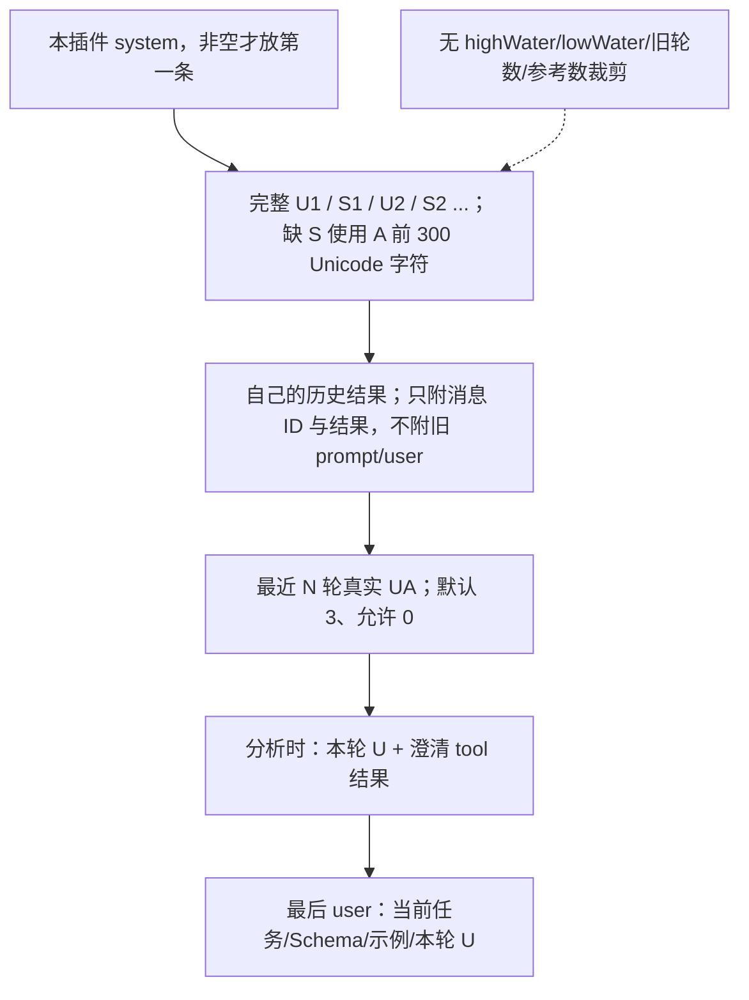
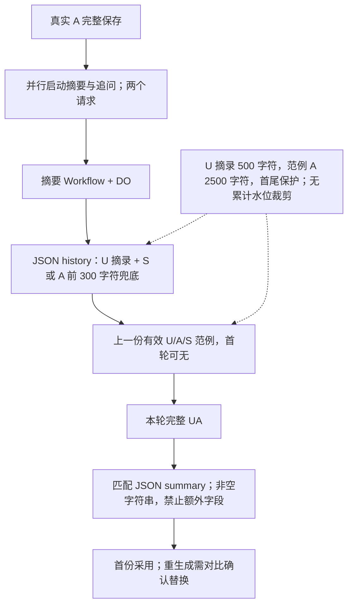

# 当前插件与摘要的输入组成

本文件描述当前实现，不把建议或旧水位字段当成仍生效的规则。提示词与流程图见 [PLUGINS.md](PLUGINS.md)。U/A 指真实聊天角色；S 指已经采用且源版本仍有效的摘要。

| 功能      | 系统消息                                              | 历史主体                                                                                | 尾部输入                                                           | 裁剪与限制                                                                                    |
| --------- | ----------------------------------------------------- | --------------------------------------------------------------------------------------- | ------------------------------------------------------------------ | --------------------------------------------------------------------------------------------- |
| 提问澄清  | 自己的可选 system，默认空白；过滤全部主 system        | 全部完整 U + 每条 A 的 S；缺 S 回退 A 前 300 Unicode 字符；自己的全部已回答问答结果                    | 最近 N 轮真实 UA JSON 补充 + 当前任务/示例/最新 U                  | N 默认 3，可为 0；无累计水位线，U 不裁剪                                                      |
| JSON 分析 | 同上，独立配置                                        | 同上；自己的全部已通过 JSON，不带旧 prompt 或重复 U                                     | 最近 N 轮真实 UA + 本轮 U/澄清 tool 问答 + 任务/Schema/示例/最新 U | N 默认 3，可为 0；本轮 U 重复和旧 JSON 字符串暂时保留                                         |
| 追问建议  | 自己可选 system（存于 prompt），默认空白；U0 必须非空 | 当前路线全部 UA 对调：原 U 完整变 A，原 A 优先取有效 S，缺失取前 300 Unicode 字符再变 U；同角色相邻合并 | 最后 user 附加第一人称行动任务；默认 3 个 suggestions              | 无轮数/水位裁剪；优先有效摘要，缺失取前 300 字符                                                                 |
| user 重写 | 同上，两者配置独立                                    | 截止目标之前的 UA 对调，原 A 优先有效 S，缺失每条前 300 字符                                            | 完整待重写文本，输出三个独立 prompt1/2/3                           | 原 U、草稿、U0、system 和任务不截断；优先有效摘要，缺失取前 300 字符                                             |
| 回复摘要  | 自己独立 system，默认内置摘要规则                     | JSON history：全部历史 U 摘录 + 已采用 S；缺 S 带 assistant_excerpt（前 300 字符），不塞旧 A 全文                   | 最近有效 U/A/S 真实范例 + 本轮 U/A 全文                            | 历史 U 超 500 字符取首尾各 250；范例 A 超 2500 取首尾各 1250；本轮不裁剪；100–150 字目标只警告 |

## 前置请求的物理顺序

历史参考只属于当前分支和当前插件；显式“重置后续参考”仍可用。所有前置结果仅通过成对的 assistant.tool_calls / tool 注入，注入模板保留可编辑。主模型本身仍按自己的上下文设置发送原文，不改为 U/S。

## 摘要请求和生命周期

摘要不写进主 assistant 正文，不计入普通聊天导出。所有任务及源版本持久保存，重连不重发模型；所有插件缺摘要时回退原 A 前 300 Unicode 字符；候选插件仍 UA 对调，摘要器兜底以 assistant_excerpt 区分，不作示例。补齐旧记录需主动点击，按当前分支串行执行；短/超长摘要提示字数，结构错误不采用，不机械截断或自动重试。

## 缓存与实际限制

U/S 主体与历史摘要链尽量按时间追加，滑动原文放在尾部；不把旧提示词复制到每组参考。新摘要补上旧缺口、人工替换、编辑/删除、切分支或修改配置都会改变前缀，实际缓存以接口报告为准。这个设计减少长 A 在前置请求中的反复发送，但新增每条完整 A 的一次摘要模型请求；不是零成本压缩。

超长用户原话在前置插件中仍完整保留，累计摘要及插件结果也不自动裁剪，所以不能保证无限上下文；界面按模型预算提示超出。缺摘要的追问/重写仍可能因前 300 字符摘取遗漏末尾事实；可手动补齐摘要改善后续请求。
