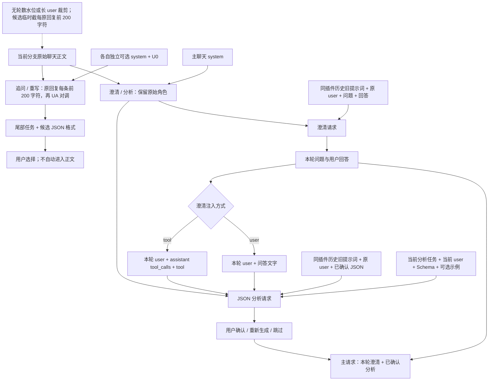

# 四个插件当前到底发送了什么上下文

核对日期：2026-10-17（Asia/Shanghai）。依据本次“候选原回复前 200 字符”的临时修复代码；以该文所在 Git 提交对应的源码为准。本文用于讨论下一步简化；第 1—7 节描述现状，第 8 节是尚未实施的建议。本次只修改追问尾部任务及两个候选插件的原回复摘取，前置插件的简化建议尚未实施。

完整默认提示词和 Schema 见 [PLUGINS.md](PLUGINS.md)。这里专门解释实际请求中的 `messages`、数据来源、重复和残留规则。

## 1. 先看结论

目前并不存在四种不同的历史裁剪算法。四个插件均不按轮数或 Token 水位裁剪；追问／重写新增临时的每原回复前 200 字符摘取。仍有两套消息组装方法：

- **追问、重写**：全部聊天消息位置（原 user 完整、原 assistant 每条前 200 字符）→ UA 对调 → 末尾追加任务。不读取旧插件输出档案。
- **澄清、JSON 分析**：完整原角色聊天历史 → 追加插件任务、旧插件提示词与结果配对；JSON 分析还会插入本轮澄清问答。

后两者更复杂，主要来自**主聊天 system、独立任务、历史插件配对、本轮跨插件数据**叠在一起，而不是目前仍在执行“只发 user／最近 N 对／长 user 截断”。

| 内容 | 追问建议 | 重新生成 user 提示 | 提问澄清 | JSON 分析 |
| --- | --- | --- | --- | --- |
| 当前分支历史 user 与 assistant 正文 | 原 user 全部；每原回复前 200 字符 | 目标之前：原 user 全部；每原回复前 200 字符 | 本轮 user 之前的全部 | 本轮 user 之前的全部 |
| 历史 UA 角色交换 | 是 | 是 | 否 | 否 |
| 主聊天 system 提示词 | 不继承 | 不继承 | 继承 | 继承 |
| 插件提示词的位置 | 可选独立 system，默认空白 | 可选独立 system，默认空白 | 最后一条 user 中的任务 | 最后一条 user 中的任务 |
| U0，默认“好的” | 有 | 有 | 无 | 无 |
| 待处理的本轮 user 内容 | 无独立待处理草稿 | 单独标记在尾部任务中 | 在尾部任务中 | 在尾部任务中；有澄清时还会单独放一条 user |
| 过去同一插件的结果 | 不带 | 不带 | 带全部已回答澄清配对 | 带全部已确认分析配对 |
| 原插件旧提示词 | 不带 | 不带 | 随历史配对一起带 | 随历史配对一起带 |
| 本轮澄清问题＋用户回答 | 不单独带 | 不单独带 | 用于等待本轮回答，不是初次提问的输入 | 单独注入，有 tool／user 两种方式 |
| 固定示例设置 | 不读取此字段 | 不读取此字段 | 非空则附上 | 非空则附上 |
| JSON Schema 设置 | 不读取此字段 | 不读取此字段 | 不附上 | 非空则附上 |
| 自动轮数／水位／单条截断 | 无轮数水位；每原回复前 200 字符 | 无轮数水位；每原回复前 200 字符 | 都不执行 | 都不执行 |

“全部”始终指选中分支，不包含其他兄弟分支，也不意味着聊天树里每条消息都发送。历史 system 消息的特别情况见第 6 节。

## 2. 用同一段聊天看清四种请求

约定：

```text
S = 主聊天设置中的系统提示词
U1 → A1 → U2 → A2 = 已有聊天正文
U3 = 本次发送的 user 要求
Q3 = 插件本轮提出的问题
R3 = 用户对 Q3 的回答
D = 输入框中正在等待重写的草稿
P = 当前插件提示词
```

下面的 `user:`、`assistant:`、`system:`、`tool:` 都表示实际 API 消息角色。文字方括号用于解释内容，不是程序另加的消息角色。

### 2.1 追问建议

正常在主回答 A2 完成后运行：

```text
system: P                         ← 仅独立插件提示词非空时存在
user: 好的                        ← 可编辑、不可为空的 U0
assistant: U1                     ← 原用户的话变成 assistant 样本
user: A1 的前 200 个 Unicode 字符
assistant: U2
user: A2 的前 200 个 Unicode 字符
      + 直接生成 N 条“我……”第一人称的下一步具体行动指令
      + suggestions JSON 格式要求
```

- 末尾任务通常直接附在 A2 对调后的那条 user 中，不额外造一组对话。
- 手动运行也以当前选中位置为截止点；如果末条对调后是 assistant，则另加一条 user 放任务。
- 当前输入框的草稿不作为独立目标发送给追问；它预测的是用户下一句。
- 不带以前生成的追问候选、重写候选、澄清档案或 JSON 档案。若用户选择了某个候选并真正发送，它才以普通历史 user 的身份出现。
- 固定示例 `example` 字段不参与这条路径；提示词里手写的示例当然仍会随 P 发送。

### 2.2 重新生成 user 提示

在同一历史之后重写草稿 D：

```text
system: P                         ← 非空时才有，默认空白
user: 好的
assistant: U1
user: A1 的前 200 个 Unicode 字符
assistant: U2
user: [前文正文，仅供背景，不是待重写对象]
      A2 的前 200 个 Unicode 字符

      [唯一待重写的用户指令]
      D                           ← 用 JSON 字符串形式标记原文

      改述要求与 prompt1 / prompt2 / prompt3 输出格式
```

- D 不会塞进 assistant 历史样本，也不会额外写入主聊天。
- 若编辑的是历史 U2：历史只到 U2 的父节点 A1；U2 原文、A2 和后续消息都不进历史。待重写内容是 U2 编辑框的当前文字。
- 没有历史时，U0 与重写任务合在唯一一条 user 消息中。
- 不带旧重写结果，没有旧插件输出档案，也没有旧 user 单独抽取层。
- 两个候选插件共用临时摘取：只截每条原 assistant 回复，原 user、完整草稿、U0、system 和尾部任务保持完整。
- 追问尾部指令已移除“发给写作助手”和“模仿历史 assistant”元话术；自定义 system 不自动重写。
- 返回三个独立字段，前端单选后替换草稿或历史编辑框；确认替换本身不发送消息。

### 2.3 提问澄清

用户发送 U3 后，澄清请求的截止点是 U3 的父节点 A2，因此 U3 不会先出现在历史里再被追加一遍：

```text
system: S                         ← 主聊天 system，不是独立澄清 system
user: U1
assistant: A1
user: U2
assistant: A2
user: 当前澄清任务 P，其中插入 U3
      + 固定示例（非空时）
      + 过去同一澄清插件的完整配对（有时）
```

如果 P 有 `{{USER_INPUT}}` 或 `{user_input}`，在该位置放入 U3；如果没有，程序自动在末尾追加“最新用户要求：U3”。若自定义 P 多次使用占位符，用户内容也会被替换进去多次。

每一组历史澄清参考实际被序列化成一行 JSON，内容是：

```json
{
  "prompt": "那一次运行时的旧插件提示词",
  "user": "那一次的原始用户请求",
  "question": "那一次插件提出的问题",
  "answer": "用户对那批问题的完整回答"
}
```

这些行全部放在**最后一条 user 的文字里**，不是恢复成真正的 assistant/user 问答消息。原 user 可能已经存在于聊天历史，因此这里会再次出现；每一组还重复携带旧 P。

只选择同一个插件 ID、锚点处于本分支、状态为 `answered` 的记录。其他插件的澄清、其他分支、未回答／跳过／被替换的问题不作为这类历史参考。

### 2.4 JSON 分析：没有本轮澄清时

```text
system: S
user: U1
assistant: A1
user: U2
assistant: A2
user: 当前分析任务 P，其中插入或追加 U3
      + JSON Schema（非空时）
      + 固定示例（非空时）
      + 过去同一分析插件的完整配对（有时）
```

历史分析配对同样是最后一条 user 里的 JSON 文本：

```json
{
  "prompt": "那一次运行时的旧分析提示词",
  "user": "那一次的原始用户请求",
  "result": "那一次已确认的 JSON 输出文本"
}
```

`result` 是保存的 JSON 字符串，不是自动展开成对象，也不是一条 assistant 消息。历史记录不附带当时的 Schema；只保存旧 prompt、旧 user、旧 result 这一组。

只选择同一个插件 ID、锚点处于本分支、状态为 `complete` 的结果。已确认分析可以成为后续参考；未确认、跳过、重新生成前被替代的结果不会以这种方式传入。

### 2.5 JSON 分析：有本轮澄清时

默认 Tool Call 注入是：

```text
system: S
user: U1
assistant: A1
user: U2
assistant: A2
user: U3                          ← 先单独放本轮要求
assistant: tool_calls 占位         ← 没有故事正文，arguments 为 {}
tool: 注入模板 + {questions: Q3, answer: R3}
user: 当前分析任务 P，其中又包含 U3
      + Schema + 固定示例 + 过去的分析配对
```

这里确实存在 **U3 重复**：一次是本轮 user，一次在尾部分析任务中。默认注入模板本身还带“以下为……辅助结果，请结合用户原始要求使用”等包装文字。

如果澄清配置选择“附加到 user”，则变为：

```text
system: S
user: U1
assistant: A1
user: U2
assistant: A2
user: U3 + 注入模板 + {questions: Q3, answer: R3}
user: 分析任务 P + U3 + Schema + 示例 + 旧分析配对
```

此时结尾会有两条连续 user。`injectPlugins` 不在这一层合并它们。这个选择取自**澄清插件的注入配置**，而不是分析插件自己的注入配置。

分析收到的是本轮已回答的完整 Q3/R3，不会把所有旧澄清档案额外全装进分析请求。旧澄清对故事产生的影响，仍可能已经体现在主聊天历史正文中。

## 3. 四个插件的整体数据流



## 4. 哪些东西没有混进请求

- 其他兄弟分支的正文和插件记录。
- 聊天列表标题、分组、头像、缓存率、用量、计时、错误日志、UI 展开状态。
- 主回复的独立 `reasoning` 字段、原始响应 `raw` 等元数据；历史组装读取的是正文 `content`。
- 所有插件运行记录的自动整包回灌。前置插件只读自己的历史配对，分析另外接收本轮澄清。
- 追问和重写输出不会自动成为历史 assistant。用户实际发送的文字才会成为普通历史消息。

如果用户自己将这些内容写进了正文，或模型把它们输出在 `content` 里，仍会随正文进入上下文。

主模型的“本轮插件注入”也不等于以后存入聊天树的 tool 消息：它是在发请求时临时组装，插件记录独立保存；后续的共同历史不会自动重放每一轮旧 tool 消息。

## 5. 截断、水位、历史条数现在到底还生不生效

| 名称 | 当前状态 |
| --- | --- |
| 主聊天“发送的对话轮数” | 主聊天自身可用；四个插件都不以它截断历史 |
| `contextMode`、`historyRounds` | 兼容字段仍存在，但不决定当前插件请求范围 |
| `userHistoryCount` | 仍有字段，但当前没有“先抽取历史 user”路径 |
| `referenceCount` | 仍有字段，但 JSON 分析不再按该数量限制历史参考 |
| `highWater`、`lowWater` | 当前有效配置归零，没有自动水位裁剪 |
| 旧 `metrics.cutoff` | 不再作为自动裁剪依据 |
| `candidateReplyExcerpt()` | 追问／重写共用的临时规则，每条原 assistant 正文取前 200 个 Unicode 字符；先截取再合并相邻角色，不调用模型 |
| `shortenUser()` | 旧“超过 2k 字保留首尾 500 字”函数仍留在源码，但当前源码没有调用点 |
| “重置后续参考” | 仍生效；这是用户主动清除旧插件配对，不是自动裁剪聊天正文 |
| 模型容量 | 用于预算展示，不触发本地静默裁剪；上游自身的窗口限制仍然存在 |

“重置后续参考”通过 `referenceReset` 标记，使下一次请求不再带此前该插件的参考配对；不删除原记录，不裁主聊天历史。旧配对里重复出现的 user，仍可能在普通聊天历史中存在。

## 6. 还有几个容易混淆的细节

1. **澄清和分析没有各自独立的 system 消息。** 设置里的插件任务 P 被放进末尾 user；实际 system 来自主聊天。主聊天 system 如果要求角色扮演、续写、特定格式，确实会一起影响这两个插件。
2. **追问和重写的 P 才是独立 system。** 默认空白，所以默认整个候选请求没有 system。主聊天 system 与历史 system 消息都不继承。
3. **前置插件的历史 system 消息并未过滤。** 除了 `chat.system` 拼成的系统消息，聊天树里若导入或保存了 role=system 的消息，也会按原角色进入这两个前置插件的历史。
4. **UA 对调会合并相邻同角色文字。** 只在请求视图中用空行合并，每条原回复先摘取前 200 字符，再合并相邻角色，原聊天消息不变；前置插件这条路径没有对应的截取或同角色合并步骤。
5. **预览不一定等于已经发出的请求。** 输入框上方上下文详情会按草稿和当前流程重新本地计算；运行记录的“本次请求快照”才是那次任务实际保存的请求。已有快照不会因后来改设置而重算。
6. **流式开关不改变上下文。** 澄清和分析可以各自关闭流式；两条传输路径使用相同的消息组装。追问、重写仍以流式请求生成候选。

## 7. 为什么前置插件显得不够干净

| 原因 | 实际影响 |
| --- | --- |
| 主聊天 system 与插件任务共存 | 任务身份混杂，尤其主 system 是写作或角色扮演指令时 |
| 每组参考都带旧 prompt | 修改提示词后，新旧任务文本同时存在 |
| 历史 user 同时存在于聊天正文和插件档案 | 相同背景重复发送 |
| 有澄清时，分析把本轮 user 放两次 | 请求更长，来源和职责更难分清 |
| 旧 JSON 作为字符串嵌在 JSON 参考里 | 需要理解多层文本包装，不是单一状态对象 |
| tool 与 user 两条注入路径 | 同样的 Q/R 会形成两种消息结构 |
| 历史限制字段和旧截断函数仍在代码里 | 阅读代码容易把兼容残留误认为当前行为 |

这些是代码确认的结构特点。它们是否导致某一次具体输出偏离，还需要看该次请求快照，不能只凭输出推断。

## 8. 建议如何简化（未实施，供讨论）

追问／重写目前的 200 字符摘取只是临时方案，后续计划加入每回复摘要器，本次尚未实现。建议先保留其余已经比较清楚的追问／重写流程，优先把澄清与分析统一为“一份历史、一条当前请求、明确的附加数据”。先不围绕省 Token 或前缀缓存增加新的裁剪分支。

| 部分 | 建议 |
| --- | --- |
| 聊天历史 | 两个前置插件都用完整原始 UA 历史，不再抽 user、不设最近 N 对、不截断 |
| system | 使用插件自己独立的任务 system；不自动继承主聊天角色扮演 system。需要的故事设定应明确作为资料，而非插件行为指令 |
| 当前 user | 单独发送一次，插件提示词不再重复嵌入 `USER_INPUT` |
| 本轮澄清 | 分析只接收一次完整问题与回答；建议统一 tool 结构，减少双路径维护 |
| 全部旧提示词与旧输出配对 | 建议默认去掉，避免把历代任务一起回灌 |
| 需要连续性的 JSON 状态 | 若确有必要，再单独讨论仅携带最近一次已确认 JSON；不要默认恢复全档案 |
| 固定示例与 Schema | 保留明确的独立配置；示例只用一份，不自动混入旧提示词 |
| 残留字段和旧函数 | 确定新结构后清理或集中到旧数据迁移层，不继续参与当前组装 |
| 四个上下文详情 | 按固定来源展示：插件 system／聊天历史／当前 user／本轮澄清／可选状态参考 |

建议目标结构：

```text
提问澄清：
  插件专用 system（静态任务、可选固定示例）
  完整原始 UA 历史
  当前 user（一次）

JSON 分析：
  插件专用 system（静态任务、Schema、可选固定示例）
  完整原始 UA 历史
  当前 user（一次）
  本轮完整澄清问答（有则一次 tool 结果）
  可选的最近状态参考（是否需要，待讨论）
```

这里的“插件专用 system”是建议的新行为，当前代码并非如此。改用独立 system 会改变与主模型的共同前缀；先以任务清晰为目标，缓存方案之后再单独验证。

## 9. 依据与核对方式

- [preparePlugin / injectPlugins / flowClarifications](../src/shared/plugins.ts)：消息组装、旧参考筛选、跨插件注入。
- [swappedHistory / candidateTask](../src/shared/candidate-requests.ts)：UA 对调、每原回复前 200 字符临时摘取、U0、重写目标和尾部格式要求。
- [advance / enqueue / queueSuggestions / pluginEndpoint](../src/server/plugins.ts)：实际运行的历史截止点、流程与历史编辑位置。
- [contextMessages / route](../src/shared/chat.ts)：原始分支历史与主聊天 system 的来源。
- [插件上下文预览](../src/client/plugins-ui.tsx)：草稿预览和运行快照的区别。

本次用虚构 U1/A1/U2/A2/U3/Q3/R3 数据调用当前组装函数核对了六种情形：追问、草稿重写、历史 user 重写、澄清、无澄清的分析、带 tool 澄清的分析。已确认实际角色顺序、本轮 U3 的重复位置和各自旧参考来源；没有读取真实聊天正文，没有发起上游模型请求。
