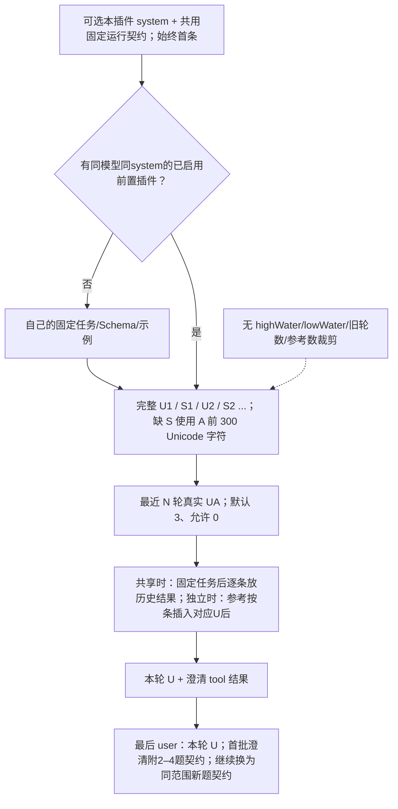
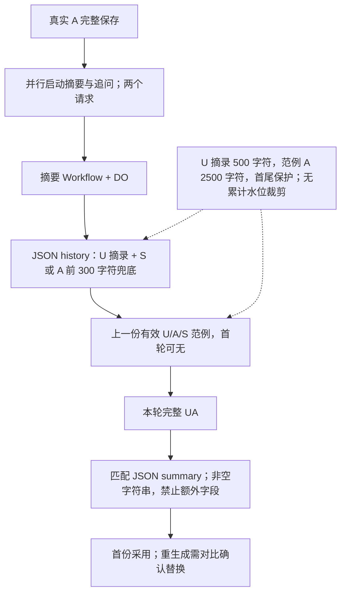

# 当前插件与摘要的输入组成

本文件描述当前实现，不把建议或旧水位字段当成仍生效的规则。提示词与流程图见 [PLUGINS.md](PLUGINS.md)。U/A 指真实聊天角色；S 指已经采用且源版本仍有效的摘要。

| 功能      | 系统消息                                              | 历史主体                                                                                | 尾部输入                                                           | 裁剪与限制                                                                                    |
| --------- | ----------------------------------------------------- | --------------------------------------------------------------------------------------- | ------------------------------------------------------------------ | --------------------------------------------------------------------------------------------- |
| 主对话 | 主聊天 system | 原始 UA；新生成的 A 还原其当时采用的工具辅助轨迹 | 当前 U 与本轮工具结果（提问仅已答题目及选中答案） | 完整当前分支，旧 rounds 不再截断；辅助轨迹不导出，旧无作用域字数工具不还原；新工具显式仅约束相邻轮次并原样还原，不影响前置插件的 UA 来源 |
| 补充提问  | 自己的可选 system（默认空白）加固定前置运行契约；过滤全部主 system        | 全部完整 U + 每条 A 的 S；缺 S 回退 A 前 300 Unicode 字符；最近 N 轮原文提前到公共部分                    | 自己的逐条已答问答 + 最新 U；固定任务按兼容伙伴决定提前或保留共享历史之后                  | N 默认 3，可为 0；无累计水位线，U 不裁剪                                                      |
| 写前分析 | 同上，独立配置及共用固定前置运行契约                                        | 同上；自己的全部已通过 JSON，不带旧 prompt 或重复 U                                     | 自己的逐条历史 JSON + 本轮 U/已答题目与答案 tool + 最新 U；固定任务与 Schema 不含动态 U | N 默认 3，可为 0；本轮 U 重复和旧 JSON 字符串暂时保留                                         |
| 追问建议  | 自己可选 system（存于 prompt），默认空白；U0 必须非空 | 当前路线全部 UA 对调：原 U 完整变 A，原 A 优先取有效 S，缺失取前 300 Unicode 字符再变 U；同角色相邻合并 | 最后 user 附加第一人称行动任务；默认 3 个 suggestions              | 无轮数/水位裁剪；优先有效摘要，缺失取前 300 字符                                                                 |
| user 重写 | 同上，两者配置独立                                    | 截止目标之前的 UA 对调，原 A 优先有效 S，缺失每条前 300 字符                                            | 完整待重写文本，输出三个独立 prompt1/2/3                           | 原 U、草稿、U0、system 和任务不截断；优先有效摘要，缺失取前 300 字符                                             |
| 回复摘要  | 自己独立 system，默认内置摘要规则                     | 逐条 JSON history 消息：全部历史 U 摘录 + 已采用 S；缺 S 带 assistant_excerpt（前 300 字符），不塞旧 A 全文                   | 最近有效 U/A/S 真实范例 + 本轮 U/A 全文                            | 历史 U 超 500 字符取首尾各 250；范例 A 超 2500 取首尾各 1250；本轮不裁剪；100–150 字目标只警告 |

## 前置请求的物理顺序

历史参考只属于当前分支和当前插件；显式“重置后续参考”仍可用。所有前置结果仅通过成对的 assistant.tool_calls / tool 注入，注入模板保留可编辑。主模型本身仍按自己的上下文设置发送原文，不改为 U/S。对象型分析Schema与结构化澄清均请求JSON对象，非对象自定义Schema不强加此格式。

辅助 `toolContext` 在主A首次生成时保存当时渲染的工具消息，不随以后模板变化重算；后续只在关联的原user仍为直接父节点时还原。复制/Fork重映射关联父节点、保留工具ID。普通导出仍仅正文及原有公开元数据；旧消息不批量回填，前置/候选/摘要均不读取这些辅助轨迹。

## 摘要请求和生命周期

摘要不写进主 assistant 正文，不计入普通聊天导出。所有任务及源版本持久保存，重连不重发模型；所有插件缺摘要时回退原 A 前 300 Unicode 字符；候选插件仍 UA 对调，摘要器兜底以 assistant_excerpt 区分，不作示例。补齐旧记录需主动点击，按当前分支串行执行；短/超长摘要提示字数，结构错误不采用，不机械截断或自动重试。

## 缓存与实际限制

U/S 主体与历史摘要链尽量按时间追加，近期原文紧随共同U/S、先于各插件参考，从而在同模型及兼容配置下共享大段原文。不把旧提示词复制到每组参考。模型无用的内部message_id改为稳定顺序位置/turn；真实ID仍只在程序内部用于版本验证。新摘要补上旧缺口、人工替换、编辑/删除、修改配置都会改变前缀，实际缓存以接口报告为准。这个设计减少长 A 在前置请求中的反复发送，但新增每条完整 A 的一次摘要模型请求；不是零成本压缩。

超长用户原话在前置插件中仍完整保留，累计摘要及插件结果也不自动裁剪，所以不能保证无限上下文；界面按模型预算提示超出。缺摘要的追问/重写仍可能因前 300 字符摘取遗漏末尾事实；可手动补齐摘要改善后续请求。

## 本轮局部修改与反复提问

写前分析的局部请求复用该轮初始快照的历史与system前缀，替换最后的全量任务为JSON局部任务：当前所有块、只读参考、目标块、新要求与单块输出契约。其他块由代码保留，指纹不一致时拒绝采用。全部重新生成仍用最初完整请求，不带后加type或局部要求；模板保存不表示自动运行。无新增水位裁剪和自动重试。

反复问复用本轮首个澄清请求快照的基础资料和任务，尾部追加本轮此前已提交问答的Tool Call。摘要中途补齐也不改写本轮基础；没有旧快照的兼容记录沿用原构建方式。默认连续提问，无开关；“提交并结束”先保存当前内容再进入分析，“提交并继续”和输入框发送请求下一批。问题/选项JSON结构独立，完整问答仅供补充提问自身避免重复；分析与主模型只接收已选择题目及答案，未选选项、整题未答均不发送，自由回答原文保留。全跳过无补充不注入。旧工具历史在主模型再次发送前同样过滤并保持调用配对。新请求只由明确提交触发；新请求首批必须2–4题，不合格报错且不放行，明确继续必须生成至少一道新题，重复/空结果报错保留问答，结束追问也会保存当前未提交的选择和文字。

局部任务将固定original_task/output_contract、排除角色与当前全部块放前面，目标/操作/新要求放末尾。候选重写的固定约束先于待重写原句；自定义system中的输入占位符指向末尾真实输入，不把草稿展开在开头。两候选窗口共享相同的UA对调资料，不给重写的最后一条摘要额外插入专属前缀。所有裁剪阈值、并行及确认操作保持不变。

离线验证可运行 `node scripts/cache-audit.mjs --baseline <旧提交>`，输出共同完整消息、文本字符及Token估算，完全不调用上游。它不能替代真实cached_tokens/缓存写入/首字时间或计费证据；无额外网页轮询、D1/DO统计缓存或预热请求。

客户端缓存展示：显式百分比优先，再由合法缓存计数/输入总量计算；否则仅展示本页捕获的同提供商/模型/格式请求的本地前缀估算，明确非真实命中，刷新丢弃。无新增CF统计请求。主回复历史辅助轨迹会增加输入量；仅保留新生成记录，旧聊天不额外请求模型回填，不保证所有场景成本下降。

插件状态变更和摘要操作可在同一POST中返回chatState，前端直接采用，省去紧接的聊天GET及导航GET；旧客户端仍可不启用。任务归属先登记再采用快照，设备任务只交付一次；现有完成推送、其他聊天导航刷新保持。

## 本地字数辅助

主回复前可选字数要求阶段：从右栏每轮默认文本或本轮输入框获得任意自由文本，未填写记为未提供。字数插件不请求模型、不读取或更改插件摘要/近期原文规则、不显示上下文卡。它在写前分析结果之后追加一对本地Tool Call，只包含上一轮要求、上一轮实际正文字符/上游输出Token、本轮要求。无上游Token则未知，字符与Token不互换。新字数Tool Call明确限定紧邻轮次，作为历史记录原样还原以稳定前缀，旧无作用域字数工具仍过滤；本轮要求只从最近一条主回复元数据取上一轮要求，不累计历史约束。其他真实工具轨迹继续保留。新主回复保存本轮要求，普通导出/旧数据不伪造缺失元数据。

v1.2.0自适应前缀、标题模板、独立主窗口对比及纯净模式规则详见 [CACHE_COMPARISON.md](CACHE_COMPARISON.md)。所有字数阈值、确认交互和上游用量显示保持，版本号不进入模型提示词。

### v1.2.1

补充提问尾部以原始本轮U限定事件范围，首批带2–4题契约，继续轮替换为范围不变的继续契约；问题允许任意组合选项，旧multiple标记不影响传输。未答整题和未选选项继续排除。写前分析固定任务/Schema加入持续类型的id、名称、通用规则，随内置四项在同一请求生成，不增加独立调用。删除仅改变后续配置（可编辑当前块可同时移除），已完成历史不改写；全量重新生成仍复用该轮冻结合同。

## v1.3.0 正文样式上下文

这是本地 Tool Call，不产生独立模型请求。主窗口 contextMessages 在首个 user 后插入固定 ID 的一组 assistant/tool 消息；只发送十种中已开启、用途非空的规则及其优先顺序，不发送颜色配置，不把映射累积存入每条回复。关闭后同一位置改为本轮短标记停用说明。未配置的旧聊天不额外插入工具。

普通对比沿用此聊天规则；纯净对比既排除工具，又移除历史 assistant 短标记但保留内容。前置、候选和摘要构建请求时去掉短标记，仅代码示例中的标记保持；有效摘要判断继续基于真实存储文本，避免移除样式导致摘要错误失效。主窗口自身历史保留原始短标记，页面用消息的 styleTagged 标志决定应用；没有旧消息批量重写，没有新增截断或累计水位。
